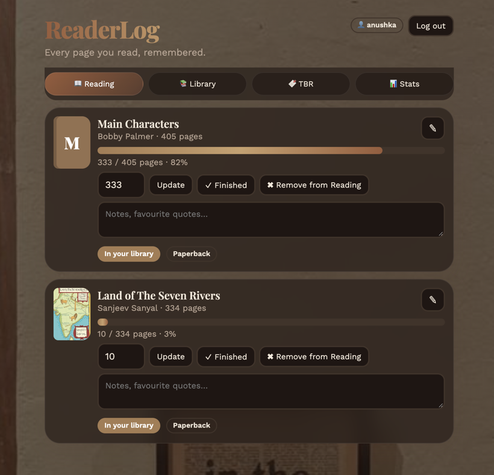
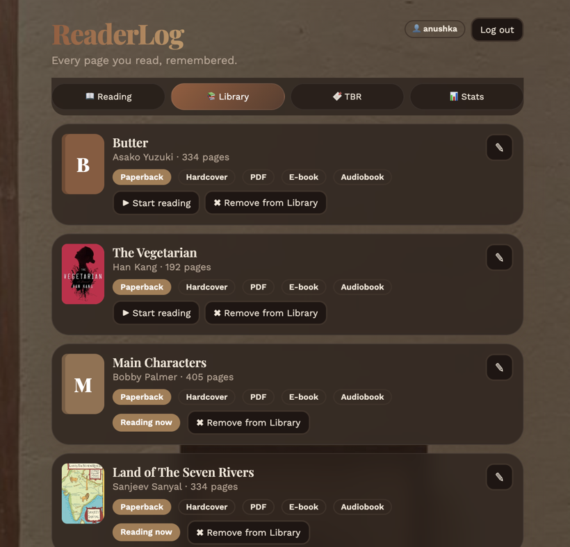
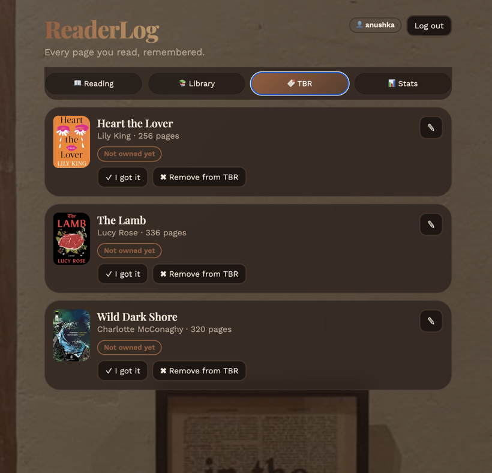
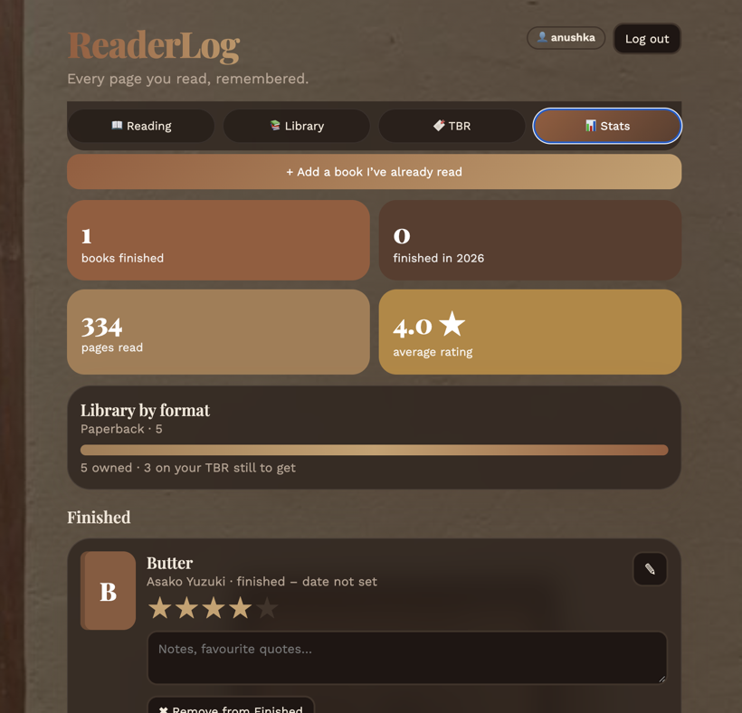

# ReaderLog

ReaderLog is a reading tracker I built to keep my books in one place, on my phone and on my laptop. It keeps track of what I'm reading right now, what's on my shelf, what I want to read next, and what I've finished. Each person gets their own account, so a shelf follows you from device to device.

It's a small project: a Python (FastAPI) backend, a SQLite database, and a frontend that lives in a single HTML file.

## Screenshots

| Reading | Library |
|:---:|:---:|
|  |  |
| **TBR** | **Stats** |
|  |  |

## What it does

**Reading.** Add the book you're on, update your page as you go, and watch the progress bar fill. If the book has chapters, ReaderLog shows roughly which one you're in. There's room for notes too.

**Library.** The books you own, tagged by format: paperback, hardcover, PDF, e-book or audiobook. Pick as many formats as you like for a single book.

**TBR.** Your want-to-read list. Each book shows whether you already own it, and one tap moves it to your library once you've bought it.

**Stats.** Books finished, books finished this year, pages read, your average rating, and a list of everything you've finished with your ratings and notes. You can also add books you read before you started using the app, with a finish date if you remember it (and without one if you don't).

A few smaller things I cared about:

- **Details fill themselves in.** Type something like `Main Characters by Bobby Palmer` and ReaderLog looks up the author, page count and cover from [Open Library](https://openlibrary.org/), with [Google Books](https://developers.google.com/books) as a backup.
- **Borrowed books stay out of your library.** Mark a book as borrowed from a library or a friend, and it won't be counted as yours.
- **Everything is editable.** Title, author, pages, chapters, current page, formats, lists, rating, notes, cover and finish date can all be changed after you add a book.
- **Your own cover photos.** Upload a picture and it becomes the book's cover.
- **Real accounts.** Sign up with a username, an email and a password. After that you can log in with either your email or your username, and you only ever see your own books. New accounts confirm their email address, and a forgotten password can be reset from a link in an email.
- **Works like an app.** Add it to your phone's home screen and it opens full screen.

## What's in the repo

```
.
├── backend.py                  # the server: accounts, sessions, books and lookup
├── shelfie-standalone.html     # the whole frontend in one file
├── manifest.json               # lets phones install it to the home screen
├── screenshots/                # the images shown in this README
└── shelfie.db                  # the database, created the first time you run it
```

The `shelfie-` file name is left over from an earlier name for the project. The server looks for that exact file name, so please don't rename it unless you also change `backend.py`.

## Running it on your own computer

You'll need Python 3.9 or newer and a modern browser.

```bash
git clone <your-repo-url>
cd <your-repo-folder>

python3 -m venv .venv
source .venv/bin/activate          # on Windows: .venv\Scripts\activate
pip install fastapi uvicorn

uvicorn backend:app --port 8000
```

Then open **http://localhost:8000**, choose **Sign up**, and add your first book.

One thing that trips people up: open the app through that `localhost` address, not by double-clicking the HTML file. The login and the database live in the server, so a page opened straight from your files has nothing to talk to.

The next time, you only need to switch the environment back on and start the server:

```bash
source .venv/bin/activate
uvicorn backend:app --port 8000
```

### Using it on your phone

If your phone is on the same Wi-Fi as your computer, start the server like this instead:

```bash
uvicorn backend:app --host 0.0.0.0 --port 8000
```

Find your computer's local address (on a Mac, `ipconfig getifaddr en0` will print it), then open `http://<that-address>:8000` on your phone. This connection isn't encrypted, so stick to a home network you trust.

## How it works

The frontend is a single HTML file that talks to the server through a small JSON API. Each book is stored as one JSON record that belongs to one user. That makes it easy to add new details to a book later without changing the database.

| Method | Endpoint | Needs login | What it does |
|---|---|---|---|
| `POST` | `/api/signup` | no | Creates an account from an email, username and password |
| `POST` | `/api/login` | no | Logs in with an email or a username (sent in the `email` field) and a password |
| `GET` | `/api/verify?token=` | no | Confirms an email address (the link in the confirmation email) |
| `POST` | `/api/resend` | no | Sends a fresh confirmation email |
| `POST` | `/api/forgot` | no | Sends a password reset email |
| `POST` | `/api/reset` | no | Sets a new password from a reset token |
| `GET` | `/api/me` | yes | Returns your email and username |
| `PUT` | `/api/me` | yes | Changes your username |
| `GET` | `/api/books` | yes | Lists your books |
| `PUT` | `/api/books/{id}` | yes | Creates or updates a book |
| `DELETE` | `/api/books/{id}` | yes | Deletes a book |
| `GET` | `/api/lookup?title=&author=` | yes | Looks up author, pages and cover on Open Library |

Requests that need a login send `Authorization: Bearer <token>`.

A book looks like this:

```json
{
  "id": "maincharacters",
  "title": "Main Characters",
  "author": "Bobby Palmer",
  "pages": 320,
  "page": 120,
  "units": { "kind": "chapters", "count": 30 },
  "formats": ["Paperback"],
  "reading": true,
  "inLib": true,
  "tbr": false,
  "borrowed": null,
  "rating": 0,
  "notes": "",
  "cover": null,
  "finished": null,
  "added": 1731900000000
}
```

The `id` is made from the title (lowercase, no punctuation, no leading "the", "a" or "an"). That's how a book on your TBR gets matched to the same book in your library.

## Security

- **Passwords** are salted and hashed with PBKDF2-SHA256 and are never stored as plain text.
- **Login attempts are limited.** Five wrong passwords for the same account in 15 minutes locks logging in to it for a while, and there's a wider limit per connection. Sign-ups, reset requests and confirmation emails are limited too. The limits live in the database, so restarting the server doesn't clear them.
- **Email confirmation.** When email is set up, a new account has to open the link in its confirmation email before it can log in. Links work once and expire after two days.
- **Password reset.** "Forgot password?" sends a one-hour, single-use link. The reply is the same whether or not the account exists, so nobody can use it to find out who has an account. Resetting a password logs the account out of every device.
- **Tokens** for confirmation and reset links are stored as hashes, so a leaked database can't be used to reset anyone's password.
- **HTTPS.** Set `FORCE_HTTPS=1` on a public server and the app redirects plain `http` to `https` and tells browsers to stay on HTTPS. Your host (Render, Railway, Fly.io, or a reverse proxy like Caddy) provides the certificate; the app can't create one itself.
- Sessions are random tokens that last 30 days, and every book belongs to the account that created it.

Still worth doing before you open the app to lots of strangers: a CAPTCHA on sign-up, a way to see and end your active sessions, and moving from SQLite to a hosted database.

## Email and other settings

Everything is optional and set through environment variables.

| Variable | What it does |
|---|---|
| `APP_URL` | The public address of your app, used in email links (for example `https://readerlog.example.com`). Defaults to `http://localhost:8000`. |
| `FORCE_HTTPS` | Set to `1` on a public server to redirect to HTTPS and send HSTS. |
| `SMTP_HOST`, `SMTP_PORT` | Your email provider's server. Port 587 (STARTTLS) or 465 (SSL). |
| `SMTP_USER`, `SMTP_PASS` | The login for that email account. |
| `MAIL_FROM` | The "from" address on emails. Defaults to `SMTP_USER`. |
| `SHELFIE_DB` | Where the SQLite file lives. |

**Running it on your own computer needs none of this.** If `SMTP_HOST` isn't set, ReaderLog prints emails in the server's console instead of sending them, and new accounts are confirmed automatically. To try "Forgot password?" locally, click it, then look in the Terminal window for the reset link and open it in your browser.

**To send real emails**, use any SMTP account: a Gmail address with an app password, or a free tier from a service like Brevo or Resend. Example:

```bash
export APP_URL=https://readerlog.example.com
export FORCE_HTTPS=1
export SMTP_HOST=smtp.example.com
export SMTP_PORT=587
export SMTP_USER=you@example.com
export SMTP_PASS=your-app-password
uvicorn backend:app --host 0.0.0.0 --port $PORT
```

Accounts created before email confirmation existed are treated as already confirmed.

## Putting it online

Any host that runs Python web apps will do, such as Render, Railway, Fly.io, or your own server behind HTTPS. The start command is:

```bash
uvicorn backend:app --host 0.0.0.0 --port $PORT
```

Three things to watch for:

- **Keep the database somewhere permanent.** Many free hosts erase local files whenever they redeploy, which would wipe everyone's books. Attach a persistent disk, or switch to a hosted database like PostgreSQL.
- **Turn on HTTPS and email.** Set `FORCE_HTTPS`, `APP_URL` and the `SMTP_*` settings described above.
- **Tell the app where the database is.** Set the `SHELFIE_DB` environment variable to the file's path, for example `/data/shelfie.db` on a mounted disk.

## Things it doesn't do (yet)

- **Page and chapter counts can be off.** Open Library and Google Books are community-maintained, and neither lists chapters reliably, so you enter chapter counts by hand.
- **No Goodreads search.** Goodreads no longer has a public API. Importing your own Goodreads export is something I'd like to add.
- **Voice input is hit and miss.** The Speak button relies on your browser's speech recognition. On a phone, the microphone key on your keyboard is usually the most reliable way to dictate.
- **It can't read books from photos.** Uploading a photo sets a book's cover, and that's all. Recognising titles from a picture needs an AI service that this version doesn't use.

## Ideas for later

- [ ] Import from a Goodreads CSV export
- [ ] Reading goals and streaks
- [ ] Barcode and ISBN scanning
- [ ] Export your library to CSV
- [ ] PostgreSQL support and a Docker setup

## Built with

- Python, [FastAPI](https://fastapi.tiangolo.com/) and SQLite on the backend
- Plain HTML, CSS and JavaScript on the frontend, all in one file
- Book data and covers from [Open Library](https://openlibrary.org/) and [Google Books](https://developers.google.com/books)
- Playfair Display and Work Sans from Google Fonts

## Contributing

Bug reports, ideas and pull requests are all welcome. If you're planning something big, please open an issue first so we can talk it through.

## License

Pick a license that suits you (the [MIT license](https://choosealicense.com/licenses/mit/) is a common choice) and add a `LICENSE` file to the repo.

## Before you push to GitHub

Add a `.gitignore` file so your database and virtual environment don't get uploaded:

```
.venv/
__pycache__/
shelfie.db
```
